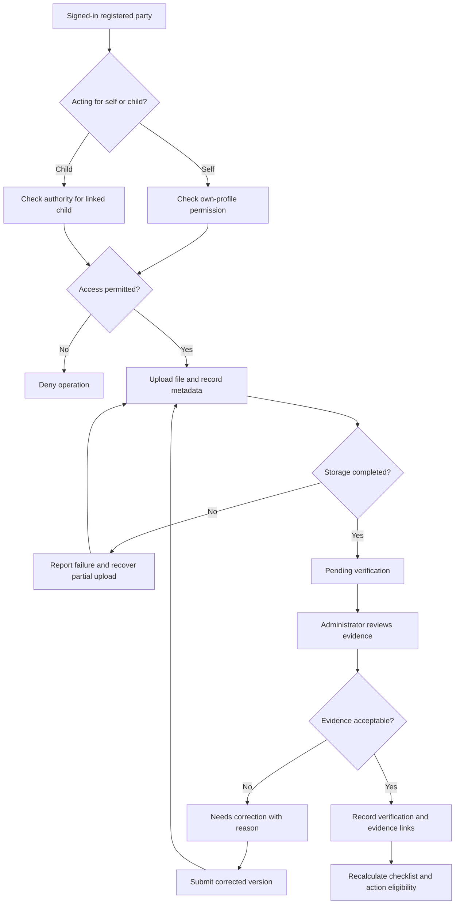
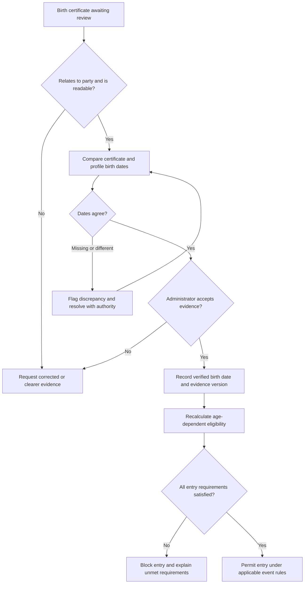
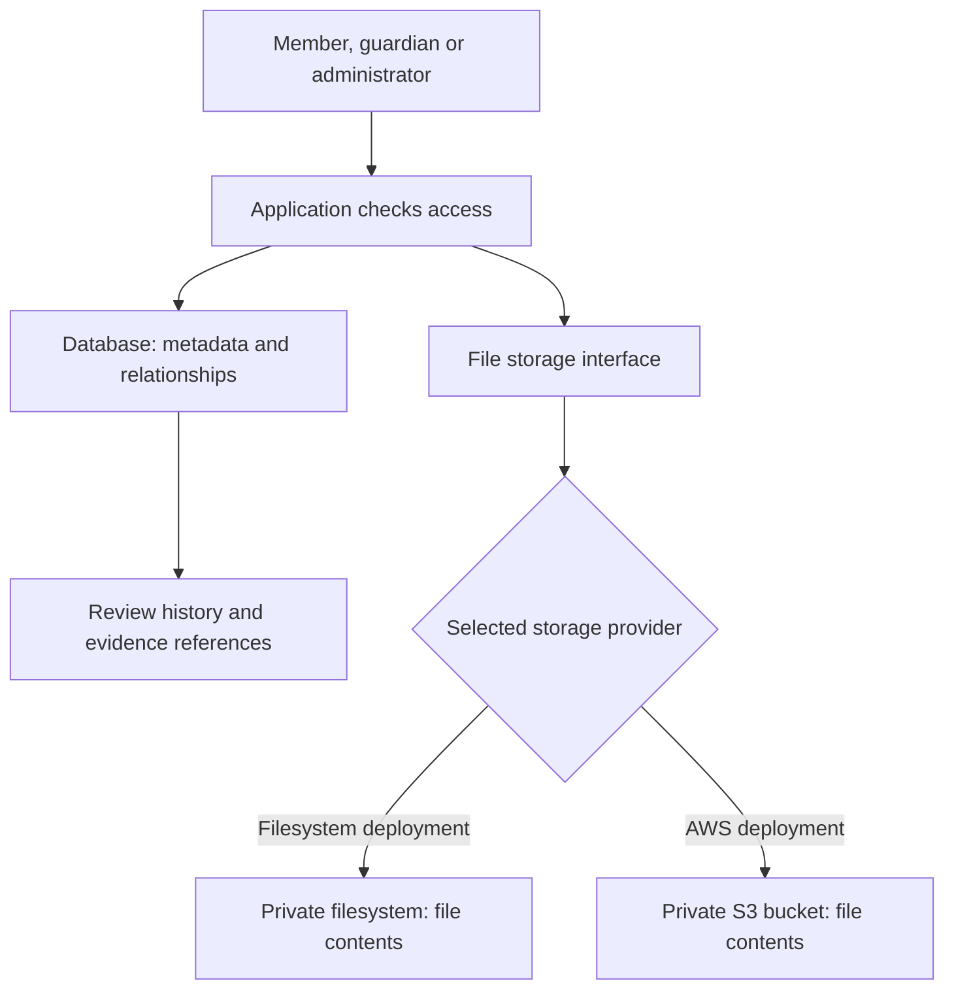

# Fish Hoek Lifesaving — Document Management Specification

## Document control

| Field | Value |
| --- | --- |
| Document ID | FHL-DMS-SPEC |
| Title | Fish Hoek Lifesaving — Document Management Specification |
| Current version | 0.2 |
| Document date | 23 November 2026 |
| Status | Draft for review and feedback |
| Prepared for | Grant Edwards / Fish Hoek Lifesaving project |
| Document owner | To be assigned |
| Approver | To be assigned |
| Approval date | Not approved |
| Scope | Functional requirements and agreed storage constraints; detailed data modelling and implementation follow review. |

### Revision history

| Version | Date | Changes | Review status |
| --- | --- | --- | --- |
| 0.1 | 23 November 2026 | Initial consolidated requirements, workflow proposals, storage constraints and review questions. | Draft issued for feedback |
| 0.2 | 23 November 2026 | Added birth-certificate verification of party date of birth, evidence traceability proposals and acceptance scenarios; added document control, revision history, linked contents and Mermaid diagrams. | Draft for review |

Version numbers in this table track revisions of this specification. Uploaded member documents have their own independent version and verification histories.

## Table of contents

- [Document control](#document-control)
  - [Revision history](#revision-history)
- [1. Purpose](#1-purpose)
- [2. Confirmed requirements](#2-confirmed-requirements)
- [3. Parties, accounts and authority](#3-parties-accounts-and-authority)
  - [3.1 Registered parties and logins](#31-registered-parties-and-logins)
  - [3.2 Parent and guardian management](#32-parent-and-guardian-management)
- [4. Classification and document types](#4-classification-and-document-types)
- [5. Document information](#5-document-information)
- [6. Upload and administrator verification](#6-upload-and-administrator-verification)
  - [6.1 Upload and review workflow](#61-upload-and-review-workflow)
  - [6.2 Birth certificate and date-of-birth verification](#62-birth-certificate-and-date-of-birth-verification)
- [7. History, verification and validity](#7-history-verification-and-validity)
- [8. Expiry and reminders](#8-expiry-and-reminders)
- [9. Role- and programme-based checklists](#9-role--and-programme-based-checklists)
- [10. Blocking specific actions](#10-blocking-specific-actions)
- [11. File storage outside the database](#11-file-storage-outside-the-database)
  - [11.1 Storage responsibility diagram](#111-storage-responsibility-diagram)
- [12. Access, handling and audit proposals](#12-access-handling-and-audit-proposals)
- [13. Draft acceptance scenarios](#13-draft-acceptance-scenarios)
- [14. Review questions and next steps](#14-review-questions-and-next-steps)

## 1. Purpose

Provide document management for registered parties, including lifesavers, donors, and children managed by parents or legal guardians. Reduce the workload of the club's small administrative team through self-service uploads, administrator verification, document checklists and renewal reminders.

Documents include identity documents, medical certificates, first aid certificates, evidence of examinations and assessments, qualifications, recommendations, awards and achievements.

This draft consolidates the discussion. **Confirmed** identifies requirements explicitly agreed by the user. **Proposed** identifies supporting details suggested during the discussion or in this draft that remain subject to review. **Open** identifies decisions still required. Examples are illustrative rather than official club or sporting-body requirements.

## 2. Confirmed requirements

| ID | Requirement |
| --- | --- |
| DM-01 | Upload and retain actual documents and link them to the relevant party. |
| DM-02 | Categorise documents, including subcategories. |
| DM-03 | Lifesavers and donors can upload their own documents. Administrators verify submitted documents. |
| DM-04 | Parents and legal guardians can create and manage linked minor profiles and upload documents on their behalf. This includes Nippers and juniors who are minors. |
| DM-05 | Multiple authorised parents or guardians can manage the same child, using separate logins. |
| DM-06 | Anyone administering documents must be a registered party in the system. Registration is a prerequisite; the appropriate permissions are also required. |
| DM-07 | The party system must support parent and legal guardian roles. Their exact representation will be resolved during data modelling. |
| DM-08 | Track expiry where applicable and provide automatic renewal reminders in the first version. |
| DM-09 | Show document checklists based on roles or programmes, including missing documents. |
| DM-10 | Unsatisfied mandatory document requirements block specifically configured actions, rather than merely displaying warnings. |
| DM-11 | Race entry must be blocked where the required identity evidence is missing or not appropriately updated and verified, because it supports age and competition-category determination. |
| DM-12 | Store file contents outside the database: in a filesystem, or in an S3 bucket if an AWS deployment is selected. Store metadata and file references in the database. |
| DM-13 | An uploaded birth certificate must be used as supporting evidence to verify the date of birth of the party to whom it relates, through the administrator verification workflow. |

## 3. Parties, accounts and authority

### 3.1 Registered parties and logins

**Confirmed:** Everyone managing documents must be registered as a party. An administrator, member, donor, parent or legal guardian must act through their own authenticated account with the applicable authority.

**Proposed:** Distinguish the party profile from the login account. A child can have a party and membership profile managed by a parent without needing an independent login. A person may hold multiple roles, such as donor, lifesaver and parent, without duplicating their party record.

### 3.2 Parent and guardian management

**Confirmed:** Multiple authorised parents or guardians may manage one child's profile. Parents may manage profiles and documentation on behalf of minors.

**Proposed:**

- Record a specific relationship between each parent or guardian and each child.
- Maintain permission to manage a child's profile separately from the existence of a family relationship. A parent or guardian role alone does not grant access to every child.
- Allow an authorised parent to manage multiple linked children.
- Keep one shared set of documents for the child; do not create separate copies for each parent.
- Link the document to its subject and separately record the party who uploaded it.
- Allow management authority to be granted and revoked while retaining the historical audit record.

**Open:** How relationships and authority are approved; how disputes or restricted access are handled; and how account control changes when a child becomes independently responsible for their profile.

## 4. Classification and document types

**Confirmed:** Support categories and subcategories.

**Proposed:** Administrators maintain the classification and document-type catalogue without code changes. A document type supplies relevant metadata requirements, expiry behaviour and verification guidance. Category names should not themselves determine access permissions.

Initial catalogue for review:

| Category | Suggested subcategory | Example document types |
| --- | --- | --- |
| Identity | National identity | South African identity document |
| Identity | Travel or birth records | Passport; birth certificate |
| Medical | Fitness and clearance | Medical certificate; fitness clearance |
| Qualifications and training | First aid | First aid certificate |
| Qualifications and training | Lifesaving | Qualification certificate; examination or assessment result |
| Qualifications and training | Boating | Skipper qualification or supporting certificate |
| Awards and achievements | Competition | Official result; achievement evidence |
| Awards and achievements | Recognition | Award; recommendation or recognition letter |
| Donor documents | Agreements and correspondence | Donation agreement; supporting correspondence |

This catalogue does not make every listed document mandatory. Mandatory requirements depend on the relevant role, programme and action. Depth of category nesting and whether a document can have multiple classifications remain open.

## 5. Document information

**Proposed metadata:**

| Group | Information |
| --- | --- |
| Identification | Stable document identifier; title; description; document type and classification |
| Subject | Party to whom the document relates; optional related qualification, assessment, award or achievement |
| Issuance | Issuing organisation; issue date; certificate or reference number where relevant |
| Validity | Expiry date where applicable; whether the document type requires expiry information |
| Submission | Uploading party; upload date and time |
| Review | Verification status; reviewing administrator; decision date and time; correction reason or review notes |
| Attribute evidence | Party attribute verified, verified value, supporting document version, verifying administrator and verification timestamp |
| History | Version identifier; preceding or superseded version; change history |
| Stored file | Storage provider and durable file reference; original filename; media type; file size; integrity checksum |

Only request fields that are relevant to the document type. Do not invent expiry dates for documents that do not expire. Rules about the age of evidence, recertification or required updates are distinct from an expiry date printed on a document and must be explicitly defined.

**Proposed distinction:** A qualification or achievement exists as a business record in its own right, with the uploaded certificate or other document serving as supporting evidence. Detailed relationships will be designed in the subsequent data-model phase.

## 6. Upload and administrator verification

**Confirmed:** Self-service upload followed by administrator verification.

**Proposed workflow:**

1. The signed-in party selects their own profile or a child profile they are authorised to manage.
2. They select the document type, provide applicable details and upload the actual file.
3. After successful file storage and metadata recording, the submission enters **Pending verification**.
4. An authorised administrator reviews the file, its subject, classification and relevant details.
5. The administrator marks it **Verified** or **Needs correction**. A correction decision includes an actionable reason.
6. The uploader or authorised profile manager can view the result and provide corrected evidence.
7. A replacement file receives a fresh review; it does not inherit the previous file's verification.

Provide a consolidated administrator review queue with filters for party, document type, programme and submission date. Members and guardians should see submission status without needing to contact administrators.

**Open:** Whether a separate rejection status is needed; whether administrators may verify their own submissions; and the exact review checks for each document type. Verification must have a defined meaning and should not imply external authenticity checks unless those checks actually occur.

### 6.1 Upload and review workflow

The diagram illustrates the proposed workflow supporting confirmed self-service upload and administrator verification. Successful upload alone does not fulfil a verification requirement.

File validation and handling controls are described in section 12. The exact review checks depend on document type.

### 6.2 Birth certificate and date-of-birth verification

**Confirmed — DM-13:** An uploaded birth certificate is evidence for verifying the date of birth of the linked party. This applies whether the party uploads it themselves or an authorised parent or guardian submits it on their behalf. Uploading the certificate alone does not verify the date of birth; administrator review remains required.

**Proposed detailed behaviour:**

1. The administrator checks that the certificate relates to the selected party and that its date of birth is readable.
2. The administrator compares the date shown on the certificate with the date recorded on the party profile.
3. If they agree and the evidence is accepted, record verification of that specific date-of-birth value, linked to the exact supporting document version, the reviewer and the review timestamp.
4. If the profile date is missing or differs, flag the issue for resolution. Do not silently overwrite the party's date of birth or mark the conflicting value as verified.
5. An authorised correction or completion of the profile date must record the previous value, new value, acting party and reason. Once resolved, the administrator can complete verification.
6. If a verified date of birth is subsequently edited, require verification of the changed value. Preserve the earlier verification as history rather than applying it to the new value.
7. Use the verified party date of birth when evaluating age-dependent eligibility and competition categories, according to the applicable event's age-reference rules. Other mandatory race-entry requirements must also be satisfied.

Document verification and verification of a particular party attribute are distinct records: accepting a file does not automatically verify every detail on the party profile. No automatic extraction or OCR capability is assumed.

**Open:** Who can correct date of birth; how conflicting identity evidence is resolved; what other document types can verify it; and how withdrawal or replacement of supporting evidence affects an existing attribute verification. This requirement does not make birth certificates mandatory for every party.

## 7. History, verification and validity

**Proposed:** Preserve earlier document versions and their review decisions when a replacement is submitted. Record who performed each material action and when.

Track these dimensions separately:

| Dimension | Example states or values |
| --- | --- |
| Verification | Pending verification; verified; needs correction |
| Time validity | No expiry applicable; current; approaching expiry; expired |
| Version lifecycle | Current; superseded; withdrawn, if supported |
| Requirement fulfilment | Missing; awaiting review; correction required; satisfied; expired |

A verified document can later expire without losing the historical fact that it was verified. An uploaded renewal is not automatically accepted evidence.

**Open:** Whether a previously verified, still-valid version continues to satisfy a requirement while its replacement is pending; withdrawal rules; retention periods; and deletion authority. Preserving history does not imply retaining every file indefinitely.

## 8. Expiry and reminders

**Confirmed:** Include expiry tracking and automatic renewal reminders in the first version.

**Proposed:**

- Configure expiry requirements and reminder schedules by document type.
- Start with reminder intervals of 60, 30 and 7 days before expiry, subject to approval.
- Notify the member or the child's authorised parents or guardians, as appropriate.
- Give administrators a view of documents approaching expiry or already expired.
- Recalculate checklist and action eligibility when a relevant document expires, even when nobody opens the profile.
- Avoid repeated duplicate notifications and retain a notification history.

**Open:** Notification channels; whether every authorised guardian is notified or a primary contact is nominated; post-expiry reminders and escalation; and the date/time convention for expiry. These are application requirements, not a request to create a reminder in ChatGPT.

## 9. Role- and programme-based checklists

**Confirmed:** Present required documents for the party's roles or programmes and identify missing items.

**Proposed:**

- Administrators configure document requirements for Nippers, junior lifesavers, senior lifesavers, donors and other supported roles or programmes.
- Combine requirements for parties holding multiple roles, avoiding duplicate requests where the same accepted evidence satisfies more than one requirement.
- Show missing, pending, correction-required, verified/current, approaching-expiry and expired evidence clearly.
- Treat a requirement as satisfied only when the evidence meets its defined rules, including verification and validity where applicable.
- Explain the next action needed for every unsatisfied requirement.

The actual mandatory document lists are not yet supplied. In particular, donor status does not automatically imply a requirement to submit identity or medical documents.

## 10. Blocking specific actions

**Confirmed:** Missing or otherwise unsatisfied mandatory documentation must block the specific actions to which that requirement applies.

The agreed example is race entry: required identity evidence supports verification of age and therefore entry into the correct competition category. Entry must be prevented until the applicable identity-document requirement is satisfied.

**Proposed:**

- Configure a mapping between each controlled action and the document requirements it depends on.
- Check eligibility when the action is attempted and explain exactly which requirement prevents completion.
- Apply the check to the person participating, even if a parent submits the entry.
- Leave unrelated activities available unless they have their own unmet requirements.
- Enforce these rules in the application's authoritative processing, not only through disabled interface buttons.
- Allow the user to reach the upload or correction workflow from the blocking message.

| Action | Evidence rule | Current decision |
| --- | --- | --- |
| Race entry | Required identity evidence must meet the agreed verification and update rules; the verified party date of birth informs the category calculation, using the applicable event reference date. | Confirmed example; detailed evidence and category rules remain open. |
| Patrol assignment | Potential medical or qualification requirements. | Discussed as an example only; not confirmed. |
| Registration completion | Potential mandatory onboarding documents. | Discussed as an example only; not confirmed. |

Do not assume that a South African ID has an expiry date. Define what “updated” identity evidence means separately. The race-category age calculation and its reference date must come from the club's applicable competition rules; neither is defined by this draft.

**Open:** Complete action/requirement matrix; treatment of entries already accepted when evidence later expires or is withdrawn; whether evidence must remain valid through the event date; and whether any authorised exception or override is permitted. No override mechanism is approved by this draft.

## 11. File storage outside the database

**Confirmed storage constraint:** The actual uploaded document must not be stored in the database. Use a filesystem or, if an AWS environment is selected, an S3 bucket. No deployment platform is selected by this specification.

| Location | Contents |
| --- | --- |
| Database | Document metadata, party and evidence relationships, permissions, verification decisions, version metadata, audit records and durable file references. |
| Filesystem | Actual uploaded file contents when filesystem storage is selected. |
| S3 bucket | Actual uploaded file contents when AWS/S3 storage is selected. |

Database records must not contain the uploaded file as a binary large object or base64-encoded payload.

**Proposed implementation constraints for later design:**

- Keep business workflows independent of the selected storage provider.
- Use an opaque, stable storage reference, with the provider information needed to locate the exact file version.
- Record a managed relative path or object key, rather than treating a temporary access link as the permanent file identity.
- Keep documents private and check the requesting party's access before allowing viewing or download.
- Use generated storage names; do not expose identity numbers or other sensitive personal details in paths or object names.
- Do not silently overwrite a verified file when a new version is uploaded.
- Record a submission as successful only when both the file and its associated metadata have been recorded successfully. Define recovery and cleanup for partial failures.
- Apply the same external-storage rule to any file previews or derived copies introduced later.

Filesystem layout, S3 configuration, encryption, backup, recovery, storage versioning and access-delivery mechanisms will be specified during technical design. This section states requirements and proposals, not a verified AWS deployment design.

### 11.1 Storage responsibility diagram

This diagram shows the confirmed separation of file contents from database records. The access checks and provider abstraction are proposed design details. Filesystem and S3 are deployment choices; the diagram does not require duplicate storage in both.

## 12. Access, handling and audit proposals

These supporting controls require review before implementation:

- Restrict viewing, download, upload and review to the relevant authorised parties and administrators.
- Treat identity and medical documents as restricted information; a coaching or donor role alone should not grant access to them.
- Record uploads, replacements, verification decisions and permission changes with the acting party and timestamp. Decide whether views and downloads also require audit records.
- Define permitted formats, file-size limits and handling of unreadable or password-protected files.
- Validate uploads and check for malicious content before making files available for normal review or download.
- Define retention, deletion, backup and recovery requirements for both files and metadata.

These are proposed product and technical controls. Detailed privacy and legal obligations require a separate assessment and are not established by this draft.

## 13. Draft acceptance scenarios

These scenarios make the proposed behaviour reviewable. They do not imply that software has been implemented or tested.

| ID | Scenario | Expected outcome |
| --- | --- | --- |
| AC-01 | Registered lifesaver uploads a certificate for themselves. | File is stored outside the database, linked to the lifesaver and queued for administrator verification. |
| AC-02 | Registered donor uploads a document for themselves. | Document is linked to the donor and follows the review workflow. |
| AC-03 | Authorised parent uploads for a linked child. | Document belongs to the child's record; the parent is recorded as uploader. |
| AC-04 | A second authorised guardian accesses the same child's documents. | The guardian sees the shared records within their granted permissions. |
| AC-05 | A relative without management authority attempts access. | Family linkage alone does not permit access. |
| AC-06 | A person without a registered party attempts document administration. | The operation is prevented. |
| AC-07 | Administrator requests correction. | The reason is visible to the authorised uploader/profile manager and the requirement remains unsatisfied. |
| AC-08 | Replacement evidence is uploaded. | A new review is required and the previous version's history is preserved. |
| AC-09 | A document reaches a configured reminder interval. | The configured recipient receives a renewal reminder through the selected channel. |
| AC-10 | An applicable verified certificate expires. | Its historical verification remains recorded; current validity and dependent eligibility are updated. |
| AC-11 | A party has more than one role. | Requirements combine; accepted shared evidence is reused where allowed. |
| AC-12 | A race entrant lacks accepted mandatory identity evidence. | Entry is blocked with an explanation and a route to resolve the missing evidence. |
| AC-13 | A parent enters a child into an event. | Eligibility is checked against the child's evidence. |
| AC-14 | File storage fails during upload. | The user is not told the submission succeeded and no usable document is represented by a broken file reference. |
| AC-15 | A readable birth certificate matches the linked party and recorded date of birth. | Following administrator acceptance, the specific date-of-birth value is marked verified with a link to the supporting document version, reviewer and timestamp. |
| AC-16 | The certificate date differs from the profile date, or the profile date is missing. | The issue is flagged and resolved through an authorised correction process before the date of birth is marked verified; no silent overwrite occurs. |
| AC-17 | A verified date of birth is subsequently changed. | The new value requires verification; the previous value and verification remain in the audit history. |

## 14. Review questions and next steps

Please use the requirement IDs and section numbers when giving feedback.

1. Confirm or amend the proposed catalogue and category structure.
2. Supply the document checklist for each role/programme and the actions each requirement controls.
3. Define acceptable identity evidence beyond birth certificates, update rules and race-category age rules; assign authority to correct date of birth and resolve conflicting evidence.
4. Confirm the review statuses, reviewer checks and who may verify which document types.
5. Decide how parent/guardian authority is approved, changed and ended.
6. Confirm notification channels, recipients and reminder intervals.
7. Set file formats, size limits, retention and deletion rules.
8. Decide the pending-renewal, existing-entry and override policies identified above.
9. Select filesystem or S3 storage when the deployment approach is decided.

After review, produce a revised functional baseline, followed by the data model, permission design, storage design and implementation plan. This draft has not changed the existing SQL model or website prototype. The updated SQL attachment was unavailable during the discussion and will be needed when integrating the approved requirements into that model.
